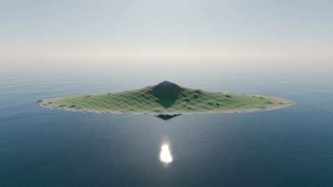

# 제주도 바다와 태양 (Blender 스크립트)

`jeju_ocean_sun.py`를 실행하면 아래 장면이 자동으로 만들어집니다.

- 제주도 섬 지형
- 출렁이는 바다
- 동쪽에서 떠서 서쪽으로 지는 태양과, 태양을 따라 움직이는 바다 위 햇빛 반사



Blender 5.2에서 오류 없이 실행되는 것을 확인했습니다. 4.2 이상 버전에서도 돌아가도록 만들었습니다.

## 1. 실행 방법 (Scripting 탭)

1. Blender를 켜고 위쪽 탭에서 **Scripting**을 누릅니다.
2. 가운데 텍스트 편집기에서 **Open**을 누르고 `jeju_ocean_sun.py`를 엽니다.
3. **▶ (Run Script)** 버튼을 누르거나 `Alt + P`를 누릅니다.
4. 10~30초쯤 기다리면 장면이 만들어집니다. **Layout** 탭으로 가서 `스페이스바`를 누르면 애니메이션이 재생됩니다.
   - 진행 메시지를 보려면 메뉴에서 *Window → Toggle System Console*을 켭니다.
   - 주의: 스크립트는 처음에 장면의 오브젝트를 **모두 지웁니다**. 지우고 싶지 않으면 맨 위의 `CLEAR_SCENE = False`로 바꿉니다.

## 2. DEM(높이 지도) 준비

DEM이 없으면 한라산 모양을 흉내 낸 **가짜 지형**으로 실행됩니다. 그래서 DEM 없이도 바로 시험해 볼 수 있습니다.

실제 제주도 지형을 쓰려면 아래 순서로 준비합니다.

1. DEM 파일을 받습니다.
   - [국토지리정보원 국토정보플랫폼](https://map.ngii.go.kr)의 수치표고모델
   - [OpenTopography](https://opentopography.org) 또는 [USGS EarthExplorer](https://earthexplorer.usgs.gov)의 SRTM 30m(무료 가입 필요)
2. [QGIS](https://qgis.org)(무료)로 제주도 부분만 잘라 냅니다. *래스터 → 추출 → 범위로 자르기*를 씁니다.
3. 잘라 낸 파일을 **GeoTIFF(.tif)** 그대로 쓰거나, 16비트 흑백 PNG로 저장합니다.
4. 스크립트 맨 위의 설정을 바꿉니다.
   ```python
   DEM_PATH = r"C:\vibe_advanced\day1\blender\jeju_dem.tif"
   DEM_WIDTH_KM = 80.0       # 잘라 낸 이미지의 실제 가로 폭(km)
   DEM_MAX_HEIGHT_M = 1947.0 # 흑백 PNG일 때: 가장 흰 곳의 높이(m)
   ```
   - GeoTIFF처럼 값이 미터 단위면 높이를 그대로 씁니다. 0~1 흑백 그림이면 `DEM_MAX_HEIGHT_M`를 곱합니다. 둘 중 어느 쪽인지는 스크립트가 알아서 판단합니다.
   - 해발 0 m 이하인 곳과 '데이터 없음' 칸(예: -9999)은 바닷속에 잠깁니다.
   - 파일을 못 읽으면 콘솔에 이유를 출력하고 가짜 지형으로 대신합니다. 이럴 때는 QGIS에서 16비트 PNG로 다시 저장해 보세요.

## 3. 렌더하기

- **그림 한 장**: `F12`를 누릅니다.
- **동영상**: 메뉴에서 *Render → Render Animation* (`Ctrl + F12`)을 누릅니다. `.blend` 파일이 있는 폴더 아래 `render/` 폴더에 mp4로 저장됩니다. 먼저 `.blend` 파일을 저장해 두세요.
- 처음 설정은 시험용(해상도 50%, 샘플 64)입니다. 최종 결과물은 `RES_PERCENT = 100`으로 바꾸세요.
- 렌더가 너무 느리면 아래 방법을 써 봅니다.
  - `RENDER_ENGINE = "EEVEE"`로 바꾸면 훨씬 빠릅니다. 대신 반사가 덜 사실적입니다.
  - 그래픽카드가 있다면 *Edit → Preferences → System → Cycles Render Devices*에서 GPU를 켭니다.

## 4. 자주 바꾸는 설정

| 설정 | 뜻 |
|---|---|
| `VERTICAL_EXAGGERATION` | 높이를 몇 배로 과장할지 (기본 3배) |
| `FRAME_END` | 애니메이션 길이 (24프레임 = 1초) |
| `SUN_MAX_ELEVATION_DEG` | 한낮에 태양이 얼마나 높이 뜰지 |
| `WAVE_SPEED` | 물결이 움직이는 속도 |
| `GRID_RES` | 지형을 얼마나 자세하게 만들지 |
